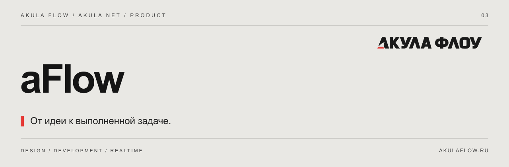

[Сайт](https://akulaflow.ru/) · [GitHub](https://github.com/yanakulov/aflow) · [GitVerse](https://gitverse.ru/yanakulov/aflow) · [Changelog](CHANGELOG.md)

# aFlow · Поток Акулы

**Проекты, доски, задачи и команда внутри aNet.**

Часть экосистемы [Akula Net](https://github.com/yanakulov/anet) от [Акулы Флоу](https://akulaflow.ru/). Работает с общей авторизацией и пользователями aNet.

## Возможности

- Проекты, доски и этапы работы.
- Задачи, исполнители и метки.
- Чек-листы, комментарии и история изменений.
- Команда из реальных пользователей установки.
- Серверные проверки прав и конфликтов ревизий.

## Подключение

Подключаемый модуль aNet. ID лицензии: `flow`.

Для работы требуется aCore и серверное разрешение на модуль.

## Версия

Описание соответствует текущей aNet **1.0.0**. Отдельная версия aFlow не заявляется. Совместимые пакеты AF — **0.2.0**.

## Другие части экосистемы

[aCore](https://github.com/yanakulov/acore) · [aVision](https://github.com/yanakulov/avision) · [aJaws](https://github.com/yanakulov/ajaws) · [aSense](https://github.com/yanakulov/asense)

## О репозитории

Это публичный информационный репозиторий: описание продукта и журнал изменений. Исходники развиваются в приватных репозиториях. Публикация описания не предоставляет лицензию на программное обеспечение.

Сайт и связь со студией: [akulaflow.ru](https://akulaflow.ru/).
